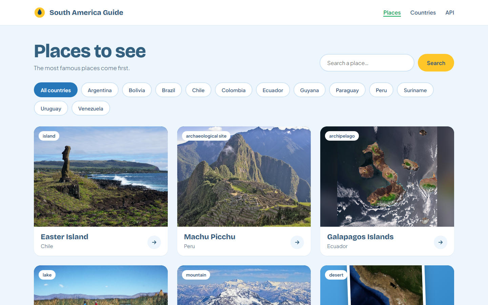
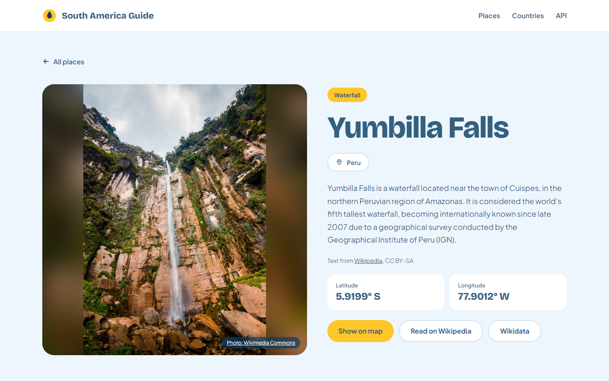
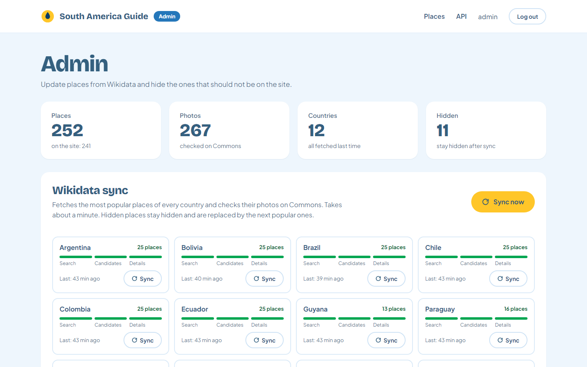
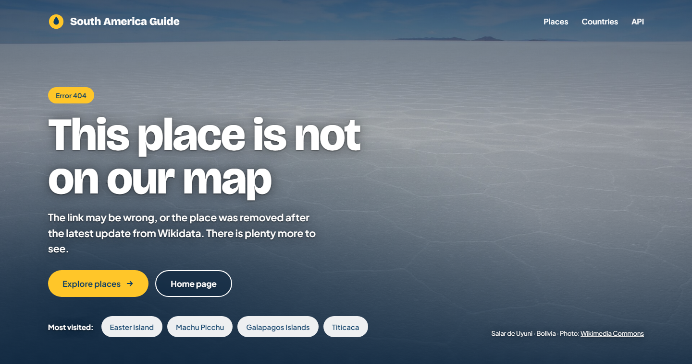

# South America Travel Guide

[](https://github.com/bulava03/south-america-travel-guide/actions/workflows/ci.yml)

A travel guide to the most famous places of the twelve South American countries: waterfalls, glaciers,
salt flats, volcanoes and old cities. Places, photos and coordinates come from Wikidata and
Wikimedia Commons, descriptions from Wikipedia. An admin panel keeps the catalog up to date.


| Places | Attraction page |
|---|---|
|  |  |

| Admin panel | Page not found |
|---|---|
|  |  |

## Tech stack

Java 21, Spring Boot 3.2 (Web, Data JPA, Security, Thymeleaf), MySQL 8.4, Flyway, Apache Jena (SPARQL),
springdoc-openapi, Docker Compose. Tests: JUnit 5, Mockito, Spring MockMvc, Playwright. CI: GitHub Actions.

## Features

- **The most popular places of every country.** Popularity is the number of Wikipedia language
  editions; at most four places of one type per country keep the list varied.
- **Photos that fit.** Every photo is checked on Commons: maps, flags and drawings are dropped,
  and each card shows the photo in the way that suits its size: cropped, whole over a blurred copy,
  or as a print when it is too small to be stretched.
- **Places in several countries** (Iguazu Falls: Argentina and Brazil) are shown once, in both countries.
- **Admin panel** with a background sync and its progress for every country, retry of a failed
  country, and hiding of places that should not be on the site; the next popular place takes their slot.
- **Public REST API** with OpenAPI documentation.

## Running

Requires Docker.

```bash
cp .env.example .env    # then set your own DB_PASSWORD and ADMIN_PASSWORD
docker compose up -d --build
```

- Site: http://localhost:8080
- Admin panel: http://localhost:8080/admin (`ADMIN_USERNAME` / `ADMIN_PASSWORD` from `.env`)
- API documentation: http://localhost:8080/swagger-ui.html

On the first start the database is empty, so the app starts a sync with Wikidata in the background.
It takes about a minute; the progress is shown in the admin panel.

To run the app from an IDE, start only the database (`docker compose up -d mysql`): the app reads
`.env`, and `DB_URL` there points to the container on port 3307.

### Configuration

| Variable | Description |
|---|---|
| `DB_USERNAME`, `DB_PASSWORD` | MySQL user, created by the container on the first start |
| `ADMIN_USERNAME`, `ADMIN_PASSWORD` | Admin panel login; the app does not start without the password |
| `DB_URL` | JDBC URL, only needed outside Docker |
| `SYNC_PER_COUNTRY_LIMIT` | Places per country, 25 by default |
| `SYNC_MAX_PER_TYPE` | Places of one type per country, 4 by default |

Countries, place types and their priority are in [`wikidata.yml`](src/main/resources/wikidata.yml);
words that mark a file as not a photo are in [`commons.yml`](src/main/resources/commons.yml).

## How the sync works

One SPARQL query by type and country is too slow for the 60-second limit of the Wikidata Query Service,
so every country is fetched in three fast steps:

1. **Search:** the Wikidata search API finds candidates of the configured types with a photo and coordinates.
2. **Candidates:** a SPARQL query ([`candidates.rq`](src/main/resources/sparql/candidates.rq)) gets their types
   and popularity; the most popular are selected, with a limit per type. Hidden places are skipped here.
3. **Details:** a second query ([`details.rq`](src/main/resources/sparql/details.rq)) gets names, coordinates,
   photos and Wikipedia links of the selected places.

Then the photos are checked on Wikimedia Commons (type and size, 50 files per request) and the result is saved.
A failed country is retried once and then skipped: its places stay as they were. A place that Wikidata
no longer returns is removed only if all its countries were fetched. The latest result of every country is
stored, so the admin panel shows when each country was synced and which ones failed.

## REST API

| Request | Description |
|---|---|
| `GET /api/attractions?country=&search=` | Places, most popular first; search by name takes precedence over the country |
| `GET /api/attractions/{id}` | Place with its Wikipedia description |
| `GET /api/countries` | Countries that have places |

Errors are returned as RFC 7807 problem details. The admin API (`/api/admin/**`) requires the admin role
and is not part of the public documentation.

## Tests

```bash
mvn test
```

Unit and MockMvc tests of the services, controllers and templates; Wikidata responses are saved fixtures,
so no network is needed.

Browser tests (Playwright) run against a separate stack with its own in-memory MySQL and test data
from [`e2e/seed`](e2e/seed), on port 8081:

```bash
docker compose -f docker-compose.e2e.yml up -d --build --wait
cd e2e
npm ci
npx playwright install chromium
npx playwright test
cd ..
docker compose -f docker-compose.e2e.yml down
```

They cover every page, the photo treatments, hover colors, phone width, sign-in and the admin panel.
Photos from Commons are replaced in the browser and the sync API is mocked, so the tests make no requests
to Wikimedia. CI runs both test suites on every push.

## Project structure

```
src/main/java/com/project/guide/
  config/       security, settings from wikidata.yml and commons.yml, startup sync
  controller/   pages, REST API, admin API, error pages
  service/      Wikidata, Commons and Wikipedia clients, sync, attractions
  dto/          data for pages and the API, photo layout
  model/        JPA entities
src/main/resources/
  db/migration/ Flyway migrations
  sparql/       Wikidata queries
  templates/    Thymeleaf pages
e2e/            Playwright tests and their test data
```

## Data and licenses

- Place data: [Wikidata](https://www.wikidata.org), CC0.
- Descriptions: [Wikipedia](https://en.wikipedia.org), [CC BY-SA 4.0](https://creativecommons.org/licenses/by-sa/4.0/).
  Every attraction page links to its article.
- Photos: [Wikimedia Commons](https://commons.wikimedia.org), under the licenses of their authors.
  Every photo links to its file page with the author and license.
- Home page photo: [Aerial view of Iguazu Falls](https://commons.wikimedia.org/wiki/File:Aerial_Foz_de_Igua%C3%A7u_26_Nov_2005.jpg);
  error pages: [Salar de Uyuni](https://commons.wikimedia.org/wiki/File:Salar_de_Uyuni_-_panoramio_(10).jpg) and
  [Torres del Paine](https://commons.wikimedia.org/wiki/File:Torres_del_Paine,_Laguna_Azul_09.jpg), Wikimedia Commons.
